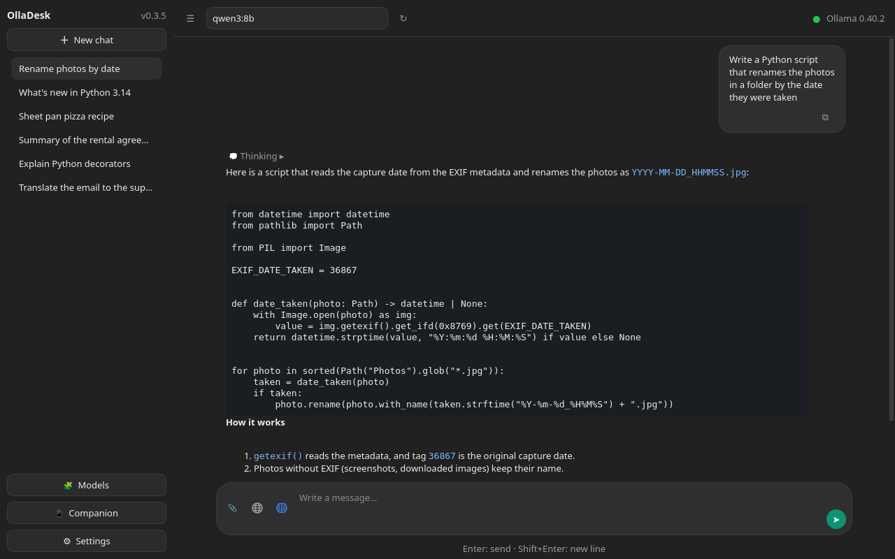
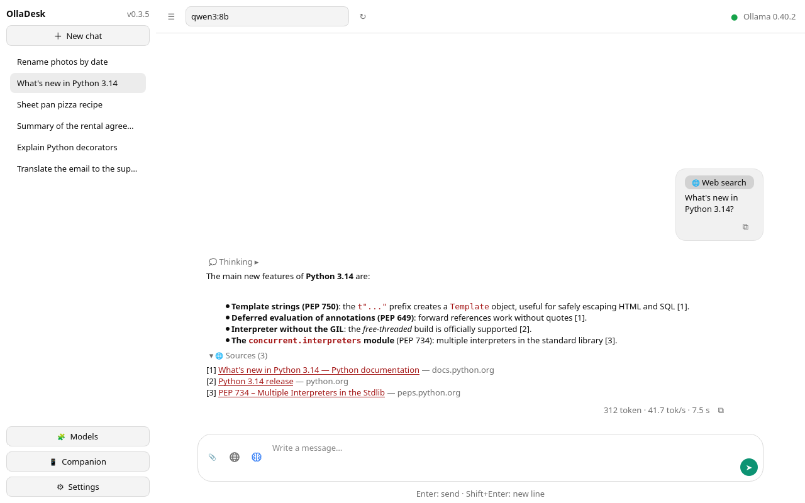
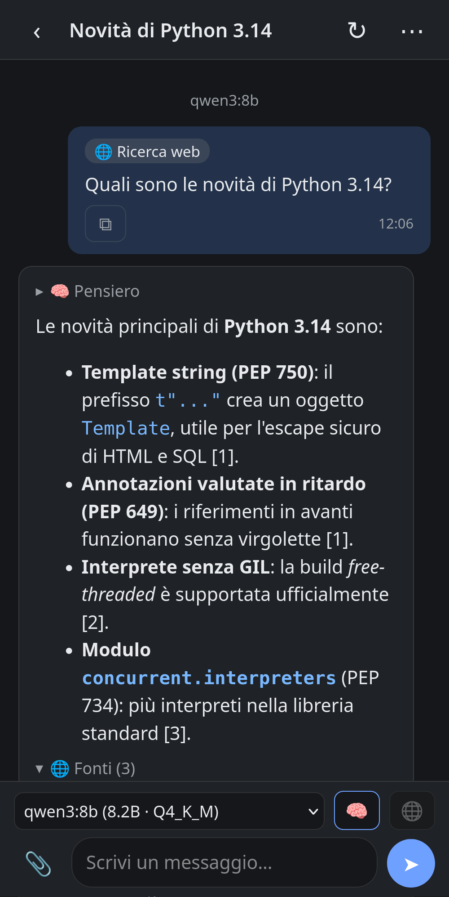
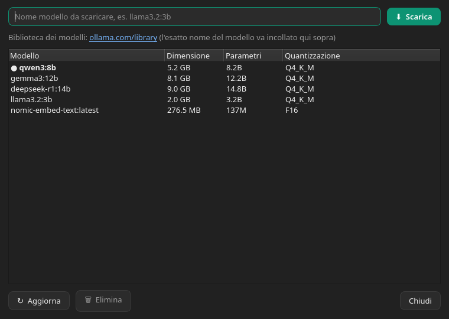

<p align="center">
  <a href="README.md"></a>
  <a href="README.fr.md"></a>
  <a href="README.de.md"></a>
  <a href="README.es.md"></a>
</p>

# OllaDesk

**OllaDesk** is a native Linux desktop application for interacting with and
managing local LLM models through [Ollama](https://ollama.com), built with
**Qt / PySide6**. Lightweight, ChatGPT-style, designed for Debian SID with
KDE Plasma.

> *A native Linux desktop application for interacting with and managing local
> LLMs through Ollama, designed with Qt/PySide6.*

License: **GPL-3.0** · Python 3.10+ · PySide6 6.6+

<p align="center">
  
  
</p>
<p align="center">
  
  
</p>

## Features

- **ChatGPT-style chat**: user/assistant bubbles, token-by-token *streaming*
  response, button to stop generation, statistics (tokens, tok/s, duration),
  Markdown rendering (code blocks, lists, bold, links…), copy button for each
  reply. The message column has a fixed maximum width and stays centered even
  when the sidebar is hidden (Ctrl+B): the content does not stretch to the
  full window. While the model is replying, the view stays where you leave it
  (you can scroll up with the wheel) and resumes following the reply when you
  scroll back to the bottom; the same applies in the web companion.
- **Multilingual interface**: Italian, English, French, German and Spanish,
  in the web companion too. It follows the system language (languages not
  yet translated fall back to English) or can be chosen in Settings →
  Interface → «Language»; it applies after a restart. The catalogs are in
  `olladesk/locale/*.po` and are updated with `python3 scripts/i18n.py update`.
- **Conversation history** in the sidebar (with the OllaDesk version in the
  header): new chat, selection, rename (right-click) and deletion; persisted
  to disk. Long titles in the sidebar are shortened with «…» to the actual
  column width.
- **Conversation archive** (right-click → "Archive"): the chat leaves the
  list without being deleted and is found again via "🗄 Archive (N)" at the
  bottom of the sidebar, from which it can be opened or restored. Writing a
  new message in an archived chat brings it back into the list. Optional
  automatic archiving on startup of chats with no messages for a given number
  of days (Settings → Interface, off by default).
- **Attachments as context** (📎 in the input): text and code files (inlined
  in the message), PDFs (requires the optional `pypdf` package) and images
  (sent as base64 to vision models: llava, llama3.2-vision, gemma3…).
  Attachments appear as chips above the input and in the message bubble.
- **Folder as context** (📎 → "Folder…", or by dragging it into the input): a
  single "📁 name/" attachment with the text, code and PDF files it contains,
  each with its relative path. JavaScript modules (`.mjs`, `.cjs`) and other
  common types (`.vue`, `.svelte`, `.swift`, `.dart`, `.cs`, `.proto`, `.tf`,
  `.nix`, `.lock`…) plus files such as `COPYING`, `CHANGELOG` and `PKGBUILD`
  are now included too; files left out because their type is not supported
  are listed in the notice. Hidden files and folders, dependencies and
  caches (`node_modules`, `__pycache__`, `venv`, `build`, `dist`…), what the
  `.gitignore` at the top of the folder excludes (with `*`, `**` and slashes
  like git, but without negations or nested `.gitignore`), likely credential
  files (`*.env`, `credentials.*`, `secrets.*`, `token.*`, `*.pem`, `*.key`,
  `id_rsa*`…, which can still be attached one by one), images, special files
  (pipes, sockets) and symlinks leaving the folder are kept out. Limits: 200
  files, 10 PDFs, 30,000 characters per file and 200,000 in total, 5,000
  entries examined (files and folders), 2 seconds between visiting and reading
  (text files first, then PDFs). A warning summarizes what was left out, and
  the model receives the same list. The folder is read at send time: only the
  path remains in the conversation.
- **Reasoning (thinking)**: with models that support it (qwen3, deepseek-r1…)
  the 🧠 button in the input enables or disables reasoning, and the model's
  thought appears in the bubble in a "💭 Thought" block in streaming,
  collapsible when the reply arrives and saved in the conversation. While the
  model thinks, the bubble doesn't just show dots: it shows "thinking…" and
  then the reasoning text.
- **Web companion** ("📱 Companion" item in the sidebar, `Ctrl+D`; off by
  default): a page for smartphones and tablets on the local network, with the
  same conversations as the PC. From the phone you read chats, open a new one
  or continue an existing one: you choose the model, turn reasoning on or off
  (🧠) and web search on or off (🌐, with the provider chosen on the PC; on
  every page load it starts off and, while it's on, the writing bar reminds
  you) and the reply arrives in streaming, with the ■ button to stop it. The
  PC generates one reply at a time: if it's already replying, the phone
  reports it and waits. PC and phone stay synchronized live: a message
  written on one side appears on the other, the chat list on the phone updates
  itself and a dot indicates the conversation that is replying. During a reply
  the PC is free to open other conversations: the reply continues in the
  background and is found again by reopening its chat.
  - **From the phone:** attachments with 📎 (photos from the camera or gallery,
    text files and PDFs, up to 20 MB each): photos are resized on the phone
    before upload and the PC passes them to models that read images. From a
    chat's "⋯" menu you rename, archive (or restore) or delete the
    conversation, even from the PC; archived ones sit in a closed box at the
    bottom of the list; the ⧉ button under each message copies its text. With
    🧩 you download (with progress and "Cancel") and delete models: the
    download happens on the PC. The rest of the settings stay on the PC only.
  - **"Companion" window:** gathers everything in one place: activation and
    port, status and address (with "Copy address"), pairing and devices. When
    active, the 📱 button in the top bar also opens the same window.
  - **Pairing:** the window shows the address, a 6-digit code valid for 2
    minutes and only once and, if `python3-qrcode` is installed
    (`python-qrcode` on Arch), a QR code to scan. The phone receives a
    session cookie; "Revoke devices" disconnects them all (at most 20 are
    remembered).
  - **On the Home screen:** from the browser menu "Add to Home Screen" the
    page becomes an icon with the OllaDesk logo. On iPhone and iPad it opens
    full screen, without the address bar, but it has separate cookies from
    Safari: pairing must be repeated the first time it's opened from the icon.
    On Android Chrome it creates a shortcut (a true installable app requires
    HTTPS, deferred to a later version).
  - **Firewall:** the PC must accept the port (default 8765) **from the local
    network only**, e.g. firewalld: `sudo firewall-cmd --permanent
    --add-rich-rule='rule family=ipv4 source address=192.168.1.0/24 port
    port=8765 protocol=tcp accept'` and `sudo firewall-cmd --reload`; analogous
    with `ufw allow from 192.168.1.0/24 to any port 8765 proto tcp`.
    Replace `192.168.1.0/24` with your LAN subnet (see it with `ip -4 addr`).
  - **Known limit:** the connection is plain HTTP, so anyone on the same Wi-Fi
    can intercept the cookie. Fine on a protected home network (WPA2/WPA3); do
    not open the port on the router. No external resources: the page works
    even without internet.
- **Third-party Ollama clients** (smartphone apps that talk to the Ollama
  API): sharing the API of versions 0.2.x was removed in 0.3, because the
  Ollama API has no authentication and the web companion does. When
  upgrading from 0.2.x with sharing on, since 0.3.6 the «Ollama server»
  field that pointed to its port goes back to `http://localhost:11434` by
  itself. Anyone who still wants to expose Ollama on the network configures
  it in the system service, **at their own risk**:
  `sudo systemctl edit ollama`, then in the `[Service]` section the line
  `Environment="OLLAMA_HOST=0.0.0.0"` and `sudo systemctl restart ollama`
  (with the same firewall rule for port 11434). Whoever reaches the port can
  use the models and the GPU: for access from outside home, better a VPN (e.g.
  Tailscale) or an SSH tunnel.
- **Tray icon**: the window minimizes to the notification area and is restored
  with a click on the icon (menu: Show/hide, Quit); optionally closing (X)
  minimizes to the tray instead of quitting, so the web companion and ongoing
  generations stay active.
- **Model management** ("Models" button in the sidebar, Ctrl+M): list of
  installed models with size/parameters/quantization, **downloading** new
  models with progress bar and cancel, and **deletion**. The model selected
  for the conversation is marked with "●". PC and phone share the same
  operation: one at a time, visible and cancellable from both, a model is not
  deleted while the PC is replying and is not used while being deleted.
  Closing the window continues the download; reopening shows its progress.
  With Ollama 0.40.0, after converting models to the new engine, Ollama's
  list reports the same name twice plus an internal `llamacpp:<sha>` entry
  ([ollama/ollama#18830](https://github.com/ollama/ollama/issues/18830)):
  OllaDesk shows each model only once and hides the internal entry (nothing
  changes on disk; `ollama list` keeps showing them).
- **Web search** (🌐 in the input, gray when off and blue when on): before
  replying, the app searches the web and attaches the results to the context.
  Under the reply the collapsible **"🌐 Sources"** block lists the results
  used, with the same numbering [1], [2]… seen by the model (also on the phone
  and in conversations saved earlier). **Provider of choice** in settings:
  - *DuckDuckGo* — no API key (may be temporarily blocked by its anti-bot
    protection: in that case the app reports it clearly);
  - *Ollama Cloud* — official endpoint `ollama.com/api/web_search`, requires
    the API key of the ollama.com account;
  - *SearXNG* — your personal instance (e.g. `http://localhost:8888`), via
    JSON API: ideal locally. The instance must have JSON output enabled — in
    SearXNG's `settings.yml`:

    ```yaml
    search:
      formats:
        - html
        - json
    ```

    If the instance responds with no results because its engines didn't
    respond (typical on cold connections), the app retries once and then lists
    the engines in error: usually raising `outgoing.request_timeout` or
    changing engines in `settings.yml` helps. If duckduckgo or brave get
    blocked (CAPTCHA, "too many requests"), disable them and enable bing or
    startpage:

    ```yaml
    outgoing:
      request_timeout: 6.0
    engines:
      - name: bing
        disabled: false
      - name: startpage
        inactive: false
        disabled: false
      - name: duckduckgo
        disabled: true
    ```

  An optional **fallback provider** (default: none; never the same as the
  main one) is tried when the main one fails or finds nothing, and a note in
  chat says which one answered. The message appears in chat right away, while
  the search is in progress.
  Only the first line of the message is used as the query (max 200
  characters), not the whole text. The number of results is configurable. Models
  don't call the tool themselves: results are injected into the prompt by the
  GUI (verified e2e).
- **Ollama updates** (Settings → Interface): compares the server version with
  the latest release on GitHub, with **one-click update** via the official
  script (run with `pkexec`, so with the KDE administrator password).
- **OllaDesk updates**: on startup, at most once a day, the app checks GitHub
  for a new version and, if so, shows a notice in the top bar with instructions
  suited to how it was installed (.deb, AUR, AppImage, pip or sources). Just a
  notice: no automatic download or install. You can skip a version, check
  manually or disable the check in Settings → Interface.
- **Settings → "Interface" tab**: Ollama server URL, dark/light/**system**
  theme (follows KDE Plasma, even hot when you change it), font size,
  streaming on/off, send with Enter, timestamps in messages, tray icon, amount
  of context sent to the model, automatic archiving of inactive chats, default
  system prompt, web search results.
- **Settings → "Model parameters" tab**: separate parameter profile for each
  model (temperature, top_k, top_p, min_p, num_ctx, num_predict, repetition/
  presence/frequency penalties, seed, stop sequences, mirostat, num_gpu,
  num_thread…). Only checked parameters are sent to Ollama: the others keep
  the server defaults. Each profile can be **saved** and **reset to defaults**
  with one click.
- Connection status always visible (green/red) with automatic recheck every
  30 s.

## Requirements

- Python 3.10+ with PySide6 (the AppImage already includes them)
- A running Ollama server (`ollama serve`) with at least one model

## Installation on Arch Linux (AUR)

The [`olladesk`](https://aur.archlinux.org/packages/olladesk) package is on
AUR. With a helper:

```bash
yay -S olladesk
```

or by hand:

```bash
git clone https://aur.archlinux.org/olladesk.git && cd olladesk
curl -LO https://github.com/gradia64/OllaDesk/releases/latest/download/olladesk-release-key.asc
gpg --import olladesk-release-key.asc   # fingerprint: see "Signature verification"
makepkg -si
```

From 0.2.5 the PKGBUILD clones the version tag from GitHub and makepkg
verifies its GPG signature (`?signed` and `validpgpkeys` in the PKGBUILD): if
the release key is not in your keyring, or it's an older copy from before
03/10/2026 without the new subkeys, the build stops. Import it (or re-import
it) from the `olladesk-release-key.asc` file attached to every release
(`gpg --import olladesk-release-key.asc`) after checking its fingerprint.
Every release also includes the already-built package
(`olladesk-<version>-1-any.pkg.tar.zst`, installable with `sudo pacman -U`).

## AppImage (any distribution)

From 0.3.4 every release includes
`OllaDesk-<version>-x86_64.AppImage`: a single file containing Python, Qt and
the optional dependencies (PDF, keyring, QR code), to download and run
without installing anything.

```bash
chmod +x OllaDesk-*-x86_64.AppImage
./OllaDesk-*-x86_64.AppImage
```

Before running it, verify the signature, as for the other files (section
"Signature verification"):

```bash
gpg --verify OllaDesk-0.3.4-x86_64.AppImage.sig OllaDesk-0.3.4-x86_64.AppImage
```

**Requirements.** 64-bit x86_64 system with glibc 2.34 or newer: Debian 12,
Ubuntu 22.04, Fedora 35, openSUSE Tumbleweed or later (it's PySide6's
minimum). From the system the AppImage uses only libraries every desktop
already has: OpenGL/EGL, xkbcommon, fontconfig, D-Bus, GLib, Kerberos
(`libgssapi_krb5`) and X11 or Wayland. To mount itself it needs FUSE
(`fusermount3`, package `fuse3`); where it's missing, for example in a
container, it runs with `./OllaDesk-*.AppImage --appimage-extract-and-run`.
Ollama is not included: it must be installed separately.

**Menu and icon.** Run as-is, OllaDesk doesn't appear in the menu and has a
generic icon in the application bar. To integrate it use
[Gear Lever](https://flathub.org/apps/it.mijorus.gearlever) or
[AppImageLauncher](https://github.com/TheAssassin/AppImageLauncher): they copy
the AppImage into a fixed folder and install the menu entry and icon, which on
Plasma also appears in the bar. To do it by hand, from the folder where you
keep the AppImage:

```bash
./OllaDesk-*-x86_64.AppImage --appimage-extract 'usr/share/*'   # only usr/share, about 1 MB
sed "s|^Exec=.*|Exec=$PWD/$(ls OllaDesk-*-x86_64.AppImage)|" \
    squashfs-root/usr/share/applications/io.github.gradia64.OllaDesk.desktop \
    > ~/.local/share/applications/io.github.gradia64.OllaDesk.desktop
install -Dm644 squashfs-root/usr/share/icons/hicolor/scalable/apps/io.github.gradia64.OllaDesk.svg \
    ~/.local/share/icons/hicolor/scalable/apps/io.github.gradia64.OllaDesk.svg
rm -r squashfs-root
```

**Updates.** The AppImage doesn't update itself: when a new version is out,
OllaDesk reports it (Settings → Interface) and indicates the file to download.
Just replace the old `.AppImage` with the new one (with Gear Lever or
AppImageLauncher, by opening the new file). With hand integration the file
name is written in the `.desktop`: after updating, repeat the commands above.

**To know.** Chats, settings and paired devices are in `~/.config/olladesk`,
the same folder as the `.deb` and the AUR package: switching to the AppImage
you find everything again, but don't open two OllaDesk at once. The API key
passes through the keyring via Secret Service (KWallet on Plasma, GNOME Keyring
elsewhere). x86_64 only: no ARM builds.

## Installation on Debian

### From the .deb package (recommended)

Download `olladesk_<version>_all.deb` from the latest
[release on GitHub](https://github.com/gradia64/OllaDesk/releases/latest)
and install it: apt resolves the dependencies on its own (Python 3.10+ and
Qt core/gui/widgets/network PySide6 modules):

```bash
sudo apt install ./olladesk_*_all.deb
```

The package installs the `/usr/bin/olladesk` launcher, the "OllaDesk" entry
in the applications menu with its icon, the manpage and the changelog;
uninstalling is `sudo apt remove olladesk`.

### Signature verification

From 0.2.3 every release file has a detached GPG signature (`.sig`) made with
the project's release key, published as `olladesk-release-key.asc` in the
release and in `packaging/` in the repository. From 0.2.5 two subkeys of the
same key sign, with separate roles: one the git tags (maintainer only), the
other the attachments (CI). The fingerprint to check stays that of the primary
key:

```
gradia (OllaDesk release signing) <gradia@disroot.org>
ed25519  5B16 6C1B 4AD7 428C 74A0  7D5B A337 0987 A057 6694
```

After importing, check that the fingerprint shown by gpg matches, then:

```bash
gpg --import olladesk-release-key.asc
gpg --verify olladesk_0.3.4_all.deb.sig olladesk_0.3.4_all.deb
# or all at once:
gpg --verify SHA256SUMS.sig SHA256SUMS && sha256sum -c --ignore-missing SHA256SUMS
```

To build the package from sources (needs `dpkg-deb`, present on any Debian):

```bash
scripts/build-deb.sh        # produces dist/olladesk_<version>_all.deb
```

### From sources

With Debian packages:

```bash
sudo apt install python3-pyside6
```

or via pip (virtual environment):

```bash
python3 -m venv .venv && source .venv/bin/activate
pip install -r requirements.txt
```

then run from the project folder:

```bash
python3 main.py
# or
python3 -m olladesk
```

### As a Python package (pipx/pip)

```bash
pipx install .            # or: pip install --user .
olladesk                  # entry point created by pyproject.toml
```

In the `.desktop` you can then use `Exec=olladesk` instead of the absolute
path.

### Integration with KDE Plasma (applications menu)

```bash
cp io.github.gradia64.OllaDesk.desktop ~/.local/share/applications/
install -Dm644 olladesk/assets/olladesk.svg \
    ~/.local/share/icons/hicolor/scalable/apps/io.github.gradia64.OllaDesk.svg
update-desktop-database ~/.local/share/applications
```

The `.desktop` uses `Exec=olladesk` (the entry point installed with
`pipx`/`pip`) and `Icon=io.github.gradia64.OllaDesk` (the icon copied above
into the `hicolor` theme). If you run the app from sources without installing
it, replace `Exec=` with `python3 /path/to/OllaDesk/main.py`.

Until 0.3.3 the files were named `olladesk.desktop` and `olladesk.svg`: if
you copied them by hand, delete them so OllaDesk doesn't appear twice in the
menu.

## Shortcuts

| Shortcut | Action |
|----------|--------|
| `Ctrl+N` | New conversation |
| `Ctrl+B` | Show/hide sidebar |
| `Ctrl+M` | Model management (download/removal) |
| `Ctrl+D` | Web companion (phone and tablet) |
| `Ctrl+,` | Open settings |
| `Enter` | Send message (configurable) |
| `Ctrl+Enter` | Send message (always) |
| `Shift+Enter` | New line |

## Model parameters

In the "Model parameters" tab each row has a customization checkbox: **only
checked parameters** are included in the `options` of the request to
`/api/chat`; the others keep Ollama's defaults, so "Reset to defaults" is
equivalent to sending no customization anymore.

Profiles are saved per-model in `~/.config/olladesk/model_params.json` and are
applied automatically to the model selected in the chat.

## Configuration files

Everything is saved in `$XDG_CONFIG_HOME/olladesk` (by default
`~/.config/olladesk`). If a configuration with the old name exists
(`~/.config/ollama-gui`), it is migrated automatically on first launch:

| Path | Content |
|------|---------|
| `settings.json` | GUI settings (the API key travels in KDE's keyring, if available) |
| `model_params.json` | Parameter profiles per model |
| `chats/index.json` | Conversation index (metadata only) |
| `chats/<id>.json` | One conversation per file: saving a message doesn't rewrite the archive |
| `attachments/` | Images pasted from the clipboard (private folder, permissions 700) |

The old monolithic `chats.json` is migrated automatically on first launch
(left as `chats.json.bak`). Attachments are referenced by path and their text
is attached to the context only in the turn in which they are sent.

## Tests

Offscreen smoke test (starts the GUI, really chats with Ollama, saves/restores
parameters and saves screenshots in `/tmp/olladesk_shots`):

```bash
python3 tests/gui_smoke.py      # basic features
python3 tests/gui_features.py   # attachments, web search, models, updates
python3 tests/gui_errors.py     # error paths (offline server)
python3 tests/unit_test.py      # unit tests of pure functions (no network)
python3 tests/repro_qthread_crash.py  # closing dialogs with blocked workers (no network)
python3 tests/release_tools_test.py   # release scripts: tag and attachment signing (no network)
```

The `gui_*.py` scripts are end-to-end checks (require Ollama and, for web
search, the network). `pytest` collects only `tests/unit_test.py`; the other
offline scripts (`release_tools_test.py`, `engine_test.py`, the companion tests
and `sync_test.py`) have their own runner and run with `python3`
(`tests/conftest.py`). Test configuration lives in a fresh temporary folder on
every run.

```bash
python3 tests/offline_app_update.py   # OllaDesk update check with fake GitHub (no network)
python3 tests/engine_test.py          # chat engine with fake Ollama (no network)
python3 tests/companion_test.py       # web companion: server, pairing, reading (no network)
python3 tests/companion_send_test.py  # web companion: sending and SSE streaming (no network)
python3 tests/sync_test.py            # phone-PC live synchronization (no network)
python3 tests/companion_models_test.py  # web companion: download and delete models (no network)
```

CI (`.github/workflows/release.yml`) runs unit tests and offline tests on every
push and pull request; on `v*` tags it builds tarball, `.deb`, AppImage and
Arch package, signs them and publishes (GitHub release and AUR). The AppImage
is tested with `packaging/appimage/smoke-test.sh`, which runs the offline
tests with its Python. Details for publishers:
[packaging/README.md](packaging/README.md).

To read PDFs as attachments:

```bash
pip install pypdf    # or: sudo apt install python3-pypdf
```

## Project structure

```
main.py                     entry point
olladesk/
  app.py                    application startup
  config.py                 persistence (settings, parameters, chats) + migration
  theme.py                  dark/light/system themes (Fusion + QSS)
  md.py                     Markdown → HTML (Qt rich text subset)
  i18n.py                   interface translations (catalogs in locale/*.po)
  context.py                attachments: text/PDF/images as context
  web_search.py             web search (DuckDuckGo/Ollama Cloud/SearXNG) + worker
  updater.py                Ollama updates (GitHub release + pkexec)
  app_update.py             OllaDesk updates (check and notice only)
  ollama_client.py          Ollama API client (stdlib) + QThread worker
  netinfo.py                local network addresses (for the web companion)
  engine.py                 chat engine: conversations, generation, saving
  workers.py                registry of active and stopping QThread workers
  companion.py              web companion: HTTP server on LAN and pairing
  web/                      mobile companion page (HTML, CSS, JS, manifest and icons)
  main_window.py            main window, chat engine client
  widgets/
    chat_area.py            message area + input (attachments, web search)
    message.py              message bubbles
    sidebar.py              conversation list
    model_params.py         parameter definitions and editor
    steppers.py             numeric fields with round −/+ buttons
    model_manager.py        model download/deletion dialog
    settings_dialog.py      settings window (2 tabs + updates)
    companion_dialog.py     companion window: service, pairing, devices
tests/gui_smoke.py          offscreen automated check (base)
tests/gui_features.py       offscreen automated check (extra features)
tests/gui_errors.py         error paths (offline)
tests/unit_test.py          unit tests of pure functions
tests/repro_qthread_crash.py regression: dialogs destroyed with blocked workers
tests/offline_app_update.py OllaDesk update check (fake GitHub)
tests/engine_test.py        chat engine (fake Ollama)
tests/companion_test.py     web companion (server, pairing, reading)
tests/companion_send_test.py web companion (sending, SSE streaming, stop)
tests/sync_test.py          phone-PC live synchronization
tests/companion_models_test.py web companion (download and delete models)
tests/fake_ollama.py        fake Ollama server for offline tests
tests/companion_client.py   HTTP/SSE client for companion tests
tests/release_tools_test.py release scripts (keys and temporary repositories)
io.github.gradia64.OllaDesk.desktop  entry for the applications menu (app ID)
io.github.gradia64.OllaDesk.metainfo.xml  AppStream metadata (software centers)
packaging/                  common .deb/Arch files, PKGBUILD template, AppImage, release key
scripts/                    build (.deb, AppImage, sources, Arch), signing, AUR publishing,
                            web icons, screenshots (docs/screenshots/, for AppStream),
                            i18n (update/check of gettext catalogs)
```

## License

This project is distributed under the **GNU General Public License
v3.0** — see the [LICENSE](LICENSE) file.
