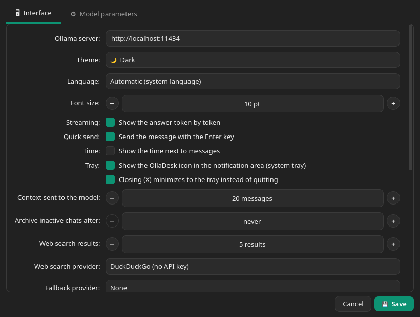

<p align="center">
  <a href="README.md"></a>
  <a href="README.en.md"></a>
  <a href="README.fr.md"></a>
  <a href="README.de.md"></a>
</p>

# OllaDesk

**OllaDesk** es una aplicación de escritorio nativa para Linux para interactuar con y gestionar modelos LLM locales mediante [Ollama](https://ollama.com), creada con **Qt / PySide6**. Ligera, estilo ChatGPT, pensada para Debian SID con KDE Plasma.

> *A native Linux desktop application for interacting with and managing local
> LLMs through Ollama, designed with Qt/PySide6.*

Licencia: **GPL-3.0** · Python 3.10+ · PySide6 6.6+

<p align="center">
  
  
</p>
<p align="center">
  
  
</p>
<p align="center">
  
</p>

## Funcionalidades

- **Chat estilo ChatGPT**: burbujas usuario/asistente, respuesta en *streaming* token a token, botón para interrumpir la generación, estadísticas (token, tok/s, duración), renderizado Markdown (bloques de código, listas, negritas, enlaces…), botón de copia para cada respuesta. La columna de mensajes tiene ancho máximo fijo y permanece centrada incluso cuando la barra lateral está oculta (Ctrl+B): el contenido no se estira a toda la ventana. Mientras el modelo responde, la vista se queda donde la dejas (se puede subir con la rueda) y vuelve a seguir la respuesta cuando bajas de nuevo al final; lo mismo vale en el companion web.
- **Interfaz multilingüe**: italiano, inglés, francés, alemán y español, también en el companion web. Sigue el idioma del sistema (los idiomas aún no traducidos usan el inglés) o se elige en Ajustes → Interfaz → «Idioma»; se aplica tras reiniciar. Los catálogos están en `olladesk/locale/*.po` y se actualizan con `python3 scripts/i18n.py update`.
- **Historial de conversaciones** en la barra lateral (con la versión de OllaDesk en el encabezado): nueva chat, selección, renombrar (clic derecho) y eliminación; persistencia en disco. Los títulos largos en la barra lateral se acortan con «…» al ancho real de la columna.
- **Archivo de conversaciones** (clic derecho → «Archivar»): la chat sale de la lista sin eliminarse y se encuentra con «🗄 Archivo (N)» al final de la barra lateral, desde donde se abre o se restaura. Escribir un nuevo mensaje en una chat archivada la devuelve a la lista. Opcional el archivado automático al iniciar las chats sin mensajes desde cierto número de días (Configuración → Interfaz, desactivado por defecto).
- **Adjuntos como contexto** (📎 en el input): archivos de texto y código (insertados en el mensaje), PDF (requiere el paquete opcional `pypdf`) e imágenes (enviadas en base64 a los modelos de visión: llava, llama3.2-vision, gemma3…). Los adjuntos aparecen como chips sobre el input y en la burbuja del mensaje.
- **Carpeta como contexto** (📎 → «Carpeta…», o arrastrándola al input): un solo adjunto «📁 nombre/» con los archivos de texto, código y PDF que contiene, cada uno con la ruta relativa. Los módulos JavaScript (`.mjs`, `.cjs`) y otros tipos comunes (`.vue`, `.svelte`, `.swift`, `.dart`, `.cs`, `.proto`, `.tf`, `.nix`, `.lock`…) más archivos como `COPYING`, `CHANGELOG` y `PKGBUILD` se incluyen ahora también; los archivos que quedan fuera porque su tipo no está soportado se listan en el aviso. Quedan fuera los archivos y carpetas ocultos, dependencias y caché (`node_modules`, `__pycache__`, `venv`, `build`, `dist`…), lo que excluye el `.gitignore` en la raíz de la carpeta (con `*`, `**` y las barras como git, pero sin negaciones ni `.gitignore` internos), los probables archivos de credenciales (`*.env`, `credentials.*`, `secrets.*`, `token.*`, `*.pem`, `*.key`, `id_rsa*`…, que se pueden adjuntar uno por uno), las imágenes, los archivos especiales (pipes, sockets) y los enlaces simbólicos que salen de la carpeta. Límites: 200 archivos, 10 PDF, 30.000 caracteres por archivo y 200.000 en total, 5000 entradas examinadas (archivos y carpetas), 2 segundos entre visita y lectura (primero los archivos de texto, luego los PDF). Un aviso resume lo que quedó fuera, y el modelo recibe la misma lista. La carpeta se lee en el momento del envío: en la conversación queda solo la ruta.
- **Razonamiento (thinking)**: con los modelos que lo soportan (qwen3, deepseek-r1…) el botón 🧠 del input activa o desactiva el razonamiento y el pensamiento del modelo aparece en la burbuja en un bloque «💭 Pensamiento» en streaming, plegable al llegar la respuesta y guardado en la conversación. Mientras el modelo piensa no se ven solo los puntos: la burbuja muestra «está pensando…» y luego el texto del razonamiento.
- **Companion web** (entrada «📱 Companion» de la barra lateral, `Ctrl+D`; desactivado por defecto): una página para smartphone y tablet en la red local, con las mismas conversaciones del PC. Desde el teléfono se leen las chats, se abre una nueva o se continúa una existente: se elige el modelo, se enciende o apaga el razonamiento (🧠) y la búsqueda web (🌐, con el proveedor elegido en el PC; en cada apertura de la página vuelve a estar apagada y, mientras está encendida, la barra de escritura lo recuerda) y la respuesta llega en streaming, con el botón ■ para interrumpirla. El PC genera una respuesta a la vez: si ya está respondiendo, el teléfono lo indica y espera. PC y teléfono permanecen sincronizados en vivo: un mensaje escrito desde un lado aparece en el otro, la lista de chats del teléfono se actualiza sola y un punto indica la conversación que está respondiendo. Durante una respuesta el PC queda libre para abrir otras conversaciones: la respuesta continúa en segundo plano y se recupera reabriendo su chat.
  - **Desde el teléfono:** adjuntos con 📎 (foto de la cámara o de la galería, archivos de texto y PDF, hasta 20 MB cada uno): las fotos se reducen en el teléfono antes de la carga y el PC las pasa a los modelos que leen imágenes. Desde el menú «⋯» de una chat se renombra, se archiva (o restaura) o se elimina la conversación, también desde el PC; las archivadas están en un recuadro cerrado al final de la lista; el botón ⧉ debajo de cada mensaje copia su texto. Con 🧩 se descargan (con progreso y «Cancelar») y eliminan los modelos: la descarga ocurre en el PC. El resto de la configuración queda solo en el PC.
  - **Ventana «Companion»:** reúne todo en un lugar: activación y puerto, estado y dirección (con «Copiar dirección»), emparejamiento y dispositivos. Cuando está activa, también el botón 📱 de la barra superior abre la misma ventana.
  - **Emparejamiento:** en la ventana aparecen la dirección, un código de 6 dígitos válido 2 minutos y una sola vez y, si está instalado `python3-qrcode` (`python-qrcode` en Arch), un código QR para escanear. El teléfono recibe una cookie de sesión; «Revocar dispositivos» los desconecta todos (se recuerdan como máximo 20).
  - **En la pantalla de inicio:** desde el menú del navegador «Añadir a pantalla de inicio» la página se convierte en un icono con el logo de OllaDesk. En iPhone y iPad se abre a pantalla completa, sin barra de direcciones, pero tiene cookies separadas de Safari: el emparejamiento se repite la primera vez que se abre desde el icono. En Android Chrome crea un acceso directo (la app instalable de verdad requiere HTTPS, pospuesto a una versión posterior).
  - **Firewall:** el PC debe aceptar el puerto (predeterminado 8765) **solo desde la red local**, ej. firewalld: `sudo firewall-cmd --permanent --add-rich-rule='rule family=ipv4 source address=192.168.1.0/24 port port=8765 protocol=tcp accept'` y `sudo firewall-cmd --reload`; análogo con `ufw allow from 192.168.1.0/24 to any port 8765 proto tcp`. Sustituye `192.168.1.0/24` por la subred de tu LAN (la ves con `ip -4 addr`).
  - **Límite conocido:** el enlace es HTTP en claro, así que quien esté en la misma Wi-Fi puede interceptar la cookie. Está bien en una red doméstica protegida (WPA2/WPA3); no abras el puerto en el router. Sin recursos externos: la página funciona también sin internet.
- **Cliente Ollama de terceros** (apps para smartphone que hablan con la API de Ollama): el compartido de la API de las versiones 0.2.x se eliminó en la 0.3, porque la API de Ollama no tiene autenticación y la companion web sí. Al actualizar desde una 0.2.x con el compartido activo, desde la 0.3.6 el campo «Servidor Ollama» que apuntaba a su puerto vuelve solo a `http://localhost:11434`. Quien quiera exponer Ollama en red lo configura en el servicio del sistema, **bajo su propia responsabilidad**: `sudo systemctl edit ollama`, luego en la sección `[Service]` la línea `Environment="OLLAMA_HOST=0.0.0.0"` y `sudo systemctl restart ollama` (con la misma regla del firewall para el puerto 11434). Quien alcance el puerto puede usar los modelos y la GPU: para el acceso desde fuera de casa mejor una VPN (ej. Tailscale) o un túnel SSH.
- **Icono en la bandeja**: la ventana se reduce al área de notificación y se restaura con un clic en el icono (menú: Mostrar/ocultar, Salir); opcionalmente el cierre (X) reduce en la bandeja en lugar de salir, así la companion web y las generaciones en curso permanecen activas.
- **Gestión de modelos** (botón «Modelos» en la barra lateral, Ctrl+M): lista de los modelos instalados con tamaño/parámetros/cuantización, **descarga** de nuevos modelos con barra de progreso y cancelación, y **eliminación**. El modelo seleccionado para la conversación está marcado con «●». PC y teléfono comparten la misma operación: se hace una a la vez, se ve y se cancela desde ambos, un modelo no se elimina mientras el PC responde y no se usa mientras se elimina. Al cerrar la ventana la descarga continúa; al reabrirla se ve el progreso. Con Ollama 0.40.0, tras la conversión de los modelos al nuevo motor, la lista de Ollama reporta el mismo nombre dos veces más una entrada interna `llamacpp:<sha>` ([ollama/ollama#18830](https://github.com/ollama/ollama/issues/18830)): OllaDesk muestra cada modelo una sola vez y oculta la entrada interna (en disco no cambia nada; `ollama list` sigue mostrándolas).
- **Búsqueda web** (🌐 en el input, gris apagada y azul activa): antes de responder, la app busca en la web y adjunta los resultados al contexto. Bajo la respuesta el bloque plegable **«🌐 Fuentes»** lista los resultados usados, con la misma numeración [1], [2]… que ve el modelo (también en el teléfono y en las conversaciones guardadas anteriormente). **Proveedor a elegir** en la configuración:
  - *DuckDuckGo* — sin clave API (puede ser bloqueado temporalmente por su protección anti-bot: en ese caso la app lo indica claramente);
  - *Ollama Cloud* — endpoint oficial `ollama.com/api/web_search`, requiere la clave API de la cuenta ollama.com;
  - *SearXNG* — tu instancia personal (ej. `http://localhost:8888`), vía API JSON: ideal en local. La instancia debe tener la salida JSON habilitada — en `settings.yml` de SearXNG:
    ```yaml
    search:
      formats:
        - html
        - json
    ```
    Si la instancia responde sin resultados porque sus motores no respondieron (típico en conexiones frías), la app reintenta una vez y luego lista los motores en error: suele ayudar subir `outgoing.request_timeout` o cambiar motores en `settings.yml`. Si duckduckgo o brave son bloqueados (CAPTCHA, «too many requests»), desactívalos y activa bing o startpage:
    ```yaml
    outgoing:
      request_timeout: 6.0
    engines:
      - name: bing
        disabled: false
      - name: startpage
        inactive: false
        disabled: false
      - name: duckduckgo
        disabled: true
    ```
  Un **proveedor de reserva** opcional (predeterminado: ninguno; nunca el mismo que el principal) se prueba cuando el principal falla o no encuentra nada, y una nota en la chat dice cuál respondió. El mensaje aparece en la chat de inmediato, mientras la búsqueda está en curso. Como consulta se usa solo la primera línea del mensaje (máximo 200 caracteres), no todo el texto. El número de resultados es configurable. Los modelos no llaman al tool por sí solos: los resultados se inyectan en el prompt desde la GUI (verificado e2e).
- **Actualizaciones de Ollama** (Configuración → Interfaz): comparación entre la versión del servidor y la última release en GitHub, con **actualización en un clic** mediante el script oficial (ejecutado con `pkexec`, por tanto con la contraseña de administrador de KDE).
- **Actualizaciones de OllaDesk**: al iniciar, como máximo una vez al día, la app comprueba en GitHub si ha salido una nueva versión y, en ese caso, muestra un aviso en la barra superior con las instrucciones adecuadas según cómo se haya instalado (.deb, AUR, AppImage, pip o fuentes). Solo un aviso: sin descarga ni instalación automática. Se puede saltar una versión, verificar a mano o desactivar el control en Configuración → Interfaz.
- **Configuración → pestaña «Interfaz»**: URL del servidor Ollama, tema oscuro/claro/**sistema** (sigue a KDE Plasma, incluso en caliente cuando lo cambias), tamaño de fuente, streaming on/off, envío con Enter, hora en los mensajes, icono en la bandeja, cantidad de contexto enviado al modelo, archivado automático de las chats inactivas, prompt de sistema predeterminado, resultados de búsqueda web.
- **Configuración → pestaña «Parámetros de modelos»**: perfil de parámetros separado para cada modelo (temperatura, top_k, top_p, min_p, num_ctx, num_predict, penalización de repetición/presencia/frecuencia, seed, secuencias de stop, mirostat, num_gpu, num_thread…). Solo los parámetros marcados se envían a Ollama: los demás permanecen en los valores predeterminados del servidor. Cada perfil puede **guardarse** y **restaurarse a los predeterminados** con un clic.
- Estado de la conexión siempre visible (verde/rojo) con recontrol automático cada 30 s.

## Requisitos

- Python 3.10+ con PySide6 (la AppImage ya los incluye)
- Un servidor Ollama en ejecución (`ollama serve`) con al menos un modelo

## Instalación en Arch Linux (AUR)

El paquete [`olladesk`](https://aur.archlinux.org/packages/olladesk) está en AUR. Con un helper:

```bash
yay -S olladesk
```

o a mano:

```bash
git clone https://aur.archlinux.org/olladesk.git && cd olladesk
curl -LO https://github.com/gradia64/OllaDesk/releases/latest/download/olladesk-release-key.asc
gpg --import olladesk-release-key.asc   # huella: ver «Verificación de firmas»
makepkg -si
```

Desde la 0.2.5 el PKGBUILD clona de GitHub el tag de la versión y makepkg verifica su firma GPG (`?signed` y `validpgpkeys` en el PKGBUILD): si la clave de release no está en tu llavero, o es una copia anterior al 03/10/2026 sin las subclaves nuevas, la build se detiene. Impórtala (o reimpórtala) desde el archivo `olladesk-release-key.asc` adjunto a cada release (`gpg --import olladesk-release-key.asc`) tras haber comprobado su huella. Cada release incluye también el paquete ya construido (`olladesk-<version>-1-any.pkg.tar.zst`, instalable con `sudo pacman -U`).

## AppImage (cualquier distribución)

Desde la 0.3.4 cada release incluye `OllaDesk-<version>-x86_64.AppImage`: un solo archivo con dentro Python, Qt y las dependencias opcionales (PDF, llavero, código QR), para descargar y ejecutar sin instalar nada.

```bash
chmod +x OllaDesk-*-x86_64.AppImage
./OllaDesk-*-x86_64.AppImage
```

Antes de ejecutarla verifica la firma, como para los demás archivos (sección «Verificación de firmas»):

```bash
gpg --verify OllaDesk-0.3.4-x86_64.AppImage.sig OllaDesk-0.3.4-x86_64.AppImage
```

**Requisitos.** Sistema de 64 bits x86_64 con glibc 2.34 o más reciente: Debian 12, Ubuntu 22.04, Fedora 35, openSUSE Tumbleweed o posteriores (es el mínimo de PySide6). Del sistema la AppImage usa solo las bibliotecas que todo escritorio ya tiene: OpenGL/EGL, xkbcommon, fontconfig, D-Bus, GLib, Kerberos (`libgssapi_krb5`) y X11 o Wayland. Para montarse necesita FUSE (`fusermount3`, paquete `fuse3`); donde falte, por ejemplo en un contenedor, se ejecuta con `./OllaDesk-*.AppImage --appimage-extract-and-run`. Ollama no está incluido: hay que instalarlo aparte.

**Menú e icono.** Ejecutada así, OllaDesk no aparece en el menú y en la barra de aplicaciones tiene un icono genérico. Para integrarla usa [Gear Lever](https://flathub.org/apps/it.mijorus.gearlever) o [AppImageLauncher](https://github.com/TheAssassin/AppImageLauncher): copian la AppImage a una carpeta fija e instalan entrada de menú e icono, que en Plasma aparece también en la barra. Para hacerlo a mano, desde la carpeta en la que guardas la AppImage:

```bash
./OllaDesk-*-x86_64.AppImage --appimage-extract 'usr/share/*'   # solo usr/share, unos 1 MB
sed "s|^Exec=.*|Exec=$PWD/$(ls OllaDesk-*-x86_64.AppImage)|" \
    squashfs-root/usr/share/applications/io.github.gradia64.OllaDesk.desktop \
    > ~/.local/share/applications/io.github.gradia64.OllaDesk.desktop
install -Dm644 squashfs-root/usr/share/icons/hicolor/scalable/apps/io.github.gradia64.OllaDesk.svg \
    ~/.local/share/icons/hicolor/scalable/apps/io.github.gradia64.OllaDesk.svg
rm -r squashfs-root
```

**Actualizaciones.** La AppImage no se actualiza sola: cuando sale una versión nueva, OllaDesk lo indica (Configuración → Interfaz) y señala el archivo a descargar. Basta sustituir el viejo `.AppImage` por el nuevo (con Gear Lever o AppImageLauncher, abriendo el archivo nuevo). Con la integración a mano el nombre del archivo está escrito en el `.desktop`: tras la actualización repite los comandos de arriba.

**A saber.** Chat, configuración y dispositivos emparejados están en `~/.config/olladesk`, la misma carpeta del `.deb` y del paquete AUR: al pasar a la AppImage recuperas todo, pero no abras dos OllaDesk a la vez. La clave API pasa del llavero mediante Secret Service (KWallet en Plasma, GNOME Keyring en otros). Solo x86_64: sin builds para ARM.

## Instalación en Debian

### Desde el paquete .deb (recomendada)

Descarga `olladesk_<version>_all.deb` de la última [release en GitHub](https://github.com/gradia64/OllaDesk/releases/latest) e instálalo: apt resuelve por sí solo las dependencias (Python 3.10+ y los módulos PySide6 de Qt core/gui/widgets/network):

```bash
sudo apt install ./olladesk_*_all.deb
```

El paquete instala el launcher `/usr/bin/olladesk`, la entrada «OllaDesk» en el menú de aplicaciones con su icono, la manpage y el changelog; la desinstalación es `sudo apt remove olladesk`.

### Verificación de firmas

Desde la 0.2.3 cada archivo de la release tiene una firma GPG desprendida (`.sig`) hecha con la clave de release del proyecto, publicada como `olladesk-release-key.asc` en la release y en `packaging/` en el repositorio. Desde la 0.2.5 firman dos subclaves de la misma clave, con roles separados: una los tags git (solo el maintainer), la otra los adjuntos (la CI). La huella que hay que comprobar sigue siendo la de la clave primaria:

```
gradia (OllaDesk release signing) <gradia@disroot.org>
ed25519  5B16 6C1B 4AD7 428C 74A0  7D5B A337 0987 A057 6694
```

Tras la importación comprueba que la huella mostrada por gpg coincida, luego:

```bash
gpg --import olladesk-release-key.asc
gpg --verify olladesk_0.3.4_all.deb.sig olladesk_0.3.4_all.deb
# o todo a la vez:
gpg --verify SHA256SUMS.sig SHA256SUMS && sha256sum -c --ignore-missing SHA256SUMS
```

Para construir el paquete desde las fuentes (hace falta `dpkg-deb`, presente en cualquier Debian):

```bash
scripts/build-deb.sh        # produce dist/olladesk_<version>_all.deb
```

### Desde las fuentes

Con los paquetes de Debian:

```bash
sudo apt install python3-pyside6
```

o vía pip (entorno virtual):

```bash
python3 -m venv .venv && source .venv/bin/activate
pip install -r requirements.txt
```

luego ejecuta desde la carpeta del proyecto:

```bash
python3 main.py
# o
python3 -m olladesk
```

### Como paquete Python (pipx/pip)

```bash
pipx install .            # o: pip install --user .
olladesk                  # entry point creado por pyproject.toml
```

En el `.desktop` puedes usar entonces `Exec=olladesk` en lugar de la ruta absoluta.

### Integración con KDE Plasma (menú de aplicaciones)

```bash
cp io.github.gradia64.OllaDesk.desktop ~/.local/share/applications/
install -Dm644 olladesk/assets/olladesk.svg \
    ~/.local/share/icons/hicolor/scalable/apps/io.github.gradia64.OllaDesk.svg
update-desktop-database ~/.local/share/applications
```

El `.desktop` usa `Exec=olladesk` (el entry point instalado con `pipx`/`pip`) e `Icon=io.github.gradia64.OllaDesk` (el icono copiado arriba en el tema `hicolor`). Si ejecutas la app desde las fuentes sin instalarla, sustituye `Exec=` por `python3 /ruta/de/OllaDesk/main.py`.

Hasta la 0.3.3 los archivos se llamaban `olladesk.desktop` y `olladesk.svg`: si los habías copiado a mano, bórralos para no tener OllaDesk dos veces en el menú.

## Atajos

| Atajo | Acción |
|-------|--------|
| `Ctrl+N` | Nueva conversación |
| `Ctrl+B` | Mostrar/ocultar la barra lateral |
| `Ctrl+M` | Gestión de modelos (descarga/eliminación) |
| `Ctrl+D` | Companion web (teléfono y tablet) |
| `Ctrl+,` | Abrir la configuración |
| `Enter` | Enviar el mensaje (activable) |
| `Ctrl+Enter` | Enviar el mensaje (siempre) |
| `Shift+Enter` | Salto de línea |

## Parámetros de los modelos

En la pestaña «Parámetros de modelos» cada fila tiene una casilla de personalización: **solo los parámetros marcados** se incluyen en la opción `options` de la petición a `/api/chat`; los demás permanecen en los valores por defecto de Ollama, así que «Restaurar predeterminados» equivale a no enviar más ninguna personalización.

Los perfiles se guardan por modelo en `~/.config/olladesk/model_params.json` y se aplican automáticamente al modelo seleccionado en la chat.

## Archivos de configuración

Todo se guarda en `$XDG_CONFIG_HOME/olladesk` (por defecto `~/.config/olladesk`). Si existe una configuración del antiguo nombre (`~/.config/ollama-gui`), se migra automáticamente al primer inicio:

| Ruta | Contenido |
|------|-----------|
| `settings.json` | Configuración de la GUI (la clave API viaja en el llavero de KDE, si está disponible) |
| `model_params.json` | Perfiles de parámetros por modelo |
| `chats/index.json` | Índice de las conversaciones (solo metadatos) |
| `chats/<id>.json` | Una conversación por archivo: guardar un mensaje no reescribe el archivo |
| `attachments/` | Imágenes pegadas desde el portapapeles (carpeta privada, permisos 700) |

El antiguo `chats.json` monolítico se migra automáticamente al primer inicio (dejado como `chats.json.bak`). Los adjuntos se referencian por ruta y su texto se adjunta al contexto solo en el turno en que se envían.

## Pruebas

Smoke test offscreen (inicia la GUI, chatea de verdad con Ollama, guarda/restaura los parámetros y guarda capturas en `/tmp/olladesk_shots`):

```bash
python3 tests/gui_smoke.py      # funcionalidad base
python3 tests/gui_features.py   # adjuntos, búsqueda web, modelos, actualizaciones
python3 tests/gui_errors.py     # rutas de error (servidor offline)
python3 tests/unit_test.py      # unit test de las funciones puras (sin red)
python3 tests/repro_qthread_crash.py  # cierre de diálogos con worker bloqueados (sin red)
python3 tests/release_tools_test.py   # script de release: firma de los tags y de los adjuntos (sin red)
```

Los scripts `gui_*.py` son pruebas end-to-end (requieren Ollama y, para la búsqueda web, red). `pytest` recoge solo `tests/unit_test.py`; los demás scripts sin red (`release_tools_test.py`, `engine_test.py`, las pruebas de la companion y `sync_test.py`) tienen su propio runner y se ejecutan con `python3` (`tests/conftest.py`). La configuración de prueba vive en una carpeta temporal nueva en cada ejecución.

```bash
python3 tests/offline_app_update.py   # control de actualizaciones con GitHub falso (sin red)
python3 tests/engine_test.py          # motor de chat con Ollama falso (sin red)
python3 tests/companion_test.py       # companion web: servidor, emparejamiento, lectura (sin red)
python3 tests/companion_send_test.py  # companion web: envío y streaming SSE (sin red)
python3 tests/sync_test.py            # sincronización teléfono-PC en vivo (sin red)
python3 tests/companion_models_test.py  # companion web: descarga y elimina modelos (sin red)
```

La CI (`.github/workflows/release.yml`) ejecuta unit tests y pruebas offline en cada push y pull request; en los tags `v*` construye tarball, `.deb`, AppImage y paquete Arch, los firma y los publica (release GitHub y AUR). La AppImage se prueba con `packaging/appimage/smoke-test.sh`, que ejecuta las pruebas offline con su Python. Detalles para quien publica: [packaging/README.md](packaging/README.md).

Para leer los PDF como adjuntos:

```bash
pip install pypdf    # o: sudo apt install python3-pypdf
```

## Estructura del proyecto

```
main.py                     punto de entrada
olladesk/
  app.py                    arranque de la aplicación
  config.py                 persistencia (settings, parámetros, chat) + migración
  theme.py                  temas oscuro/claro/sistema (Fusion + QSS)
  md.py                     Markdown → HTML (subset Qt rich text)
  i18n.py                   traducciones de la interfaz (catálogos en locale/*.po)
  context.py                adjuntos: texto/PDF/imágenes como contexto
  web_search.py             búsqueda web (DuckDuckGo/Ollama Cloud/SearXNG) + worker
  updater.py                actualizaciones de Ollama (release GitHub + pkexec)
  app_update.py             actualizaciones de OllaDesk (solo control y aviso)
  ollama_client.py          cliente API Ollama (stdlib) + worker QThread
  netinfo.py                direcciones de red local (para la companion web)
  engine.py                 motor de chat: conversaciones, generación, guardado
  workers.py                registro de los worker QThread activos y en parada
  companion.py              companion web: servidor HTTP en LAN y emparejamiento
  web/                      página móvil de la companion (HTML, CSS, JS, manifest e iconos)
  main_window.py            ventana principal, cliente del motor de chat
  widgets/
    chat_area.py            área de mensajes + input (adjuntos, búsqueda web)
    message.py              burbujas de los mensajes
    sidebar.py              lista de conversaciones
    model_params.py         definiciones y editor de parámetros
    steppers.py             campos numéricos con botones redondos −/+
    model_manager.py        diálogo de descarga/eliminación de modelos
    settings_dialog.py      ventana de configuración (2 pestañas + actualizaciones)
    companion_dialog.py     ventana de la companion: servicio, emparejamiento, dispositivos
tests/gui_smoke.py          collaudo automático offscreen (base)
tests/gui_features.py       collaudo automático offscreen (funcionalidad extra)
tests/gui_errors.py         rutas de error (offline)
tests/unit_test.py          unit test de las funciones puras
tests/repro_qthread_crash.py regresión: diálogos destruidos con worker bloqueados
tests/offline_app_update.py control de actualizaciones de OllaDesk (GitHub falso)
tests/engine_test.py        motor de chat (Ollama falso)
tests/companion_test.py     companion web (servidor, emparejamiento, lectura)
tests/companion_send_test.py companion web (envío, streaming SSE, stop)
tests/sync_test.py          sincronización teléfono-PC en vivo
tests/companion_models_test.py companion web (descarga y elimina modelos)
tests/fake_ollama.py        falso servidor Ollama para las pruebas offline
tests/companion_client.py   cliente HTTP/SSE para las pruebas de la companion
tests/release_tools_test.py script de release (claves y repositorios temporales)
io.github.gradia64.OllaDesk.desktop  entrada para el menú de aplicaciones (ID de la app)
io.github.gradia64.OllaDesk.metainfo.xml  metadatos AppStream (centros de software)
packaging/                  archivos comunes .deb/Arch, modelo PKGBUILD, AppImage, clave de release
scripts/                    build (.deb, AppImage, fuentes, Arch), firma, publicación AUR,
                            iconos web, capturas (docs/screenshots/, para AppStream),
                            i18n (actualización/comprobación de catálogos gettext)
```

## Licencia

Este proyecto se distribuye bajo licencia **GNU General Public License v3.0** — ver el archivo [LICENSE](LICENSE).
