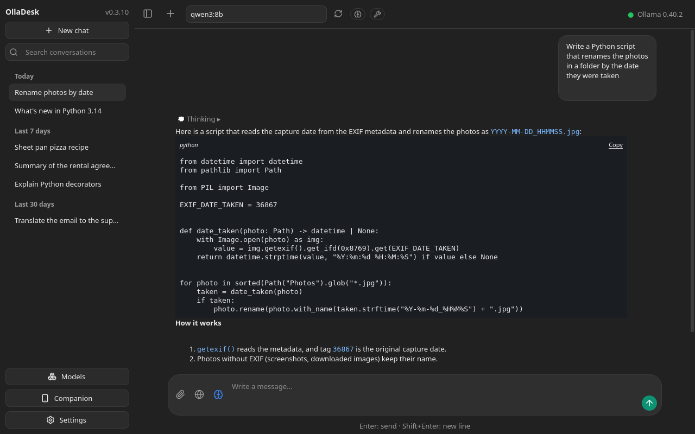
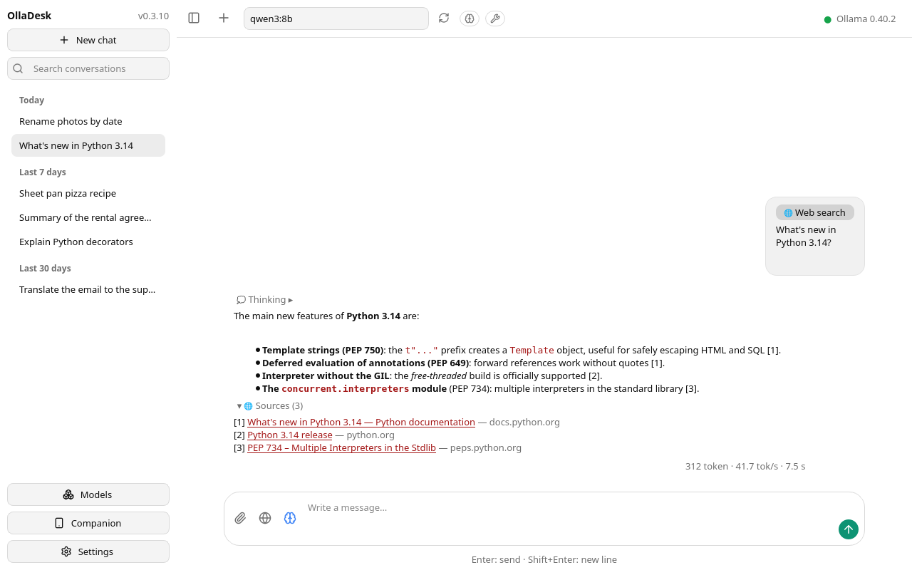
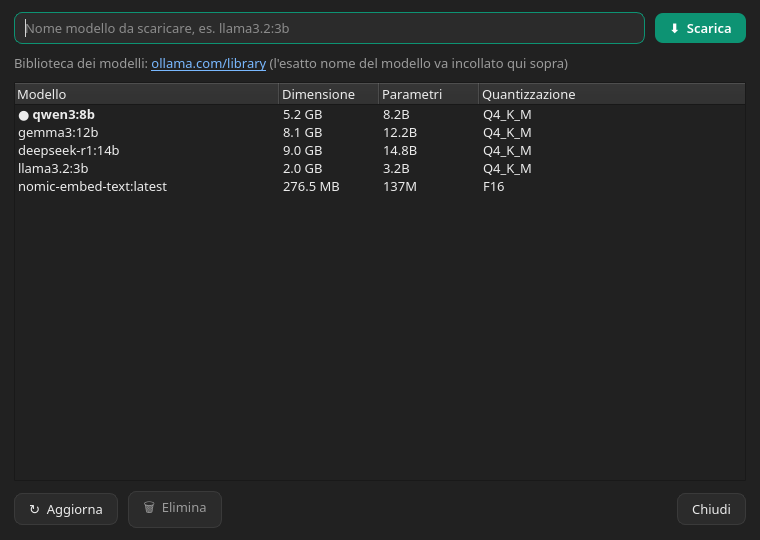
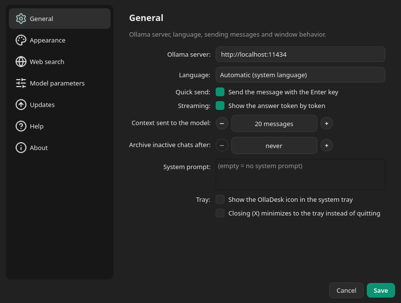
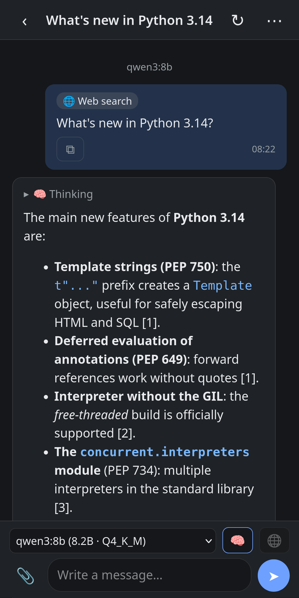

<p align="center">
  <a href="README.md"></a>
  <a href="README.it.md"></a>
  <a href="README.de.md"></a>
  <a href="README.es.md"></a>
</p>

# OllaDesk

**OllaDesk** est une application de bureau native pour Linux permettant d'interagir avec et de gérer les modèles LLM locaux via [Ollama](https://ollama.com), réalisée avec **Qt / PySide6**. Légère, dans le style ChatGPT, pensée pour Debian SID avec KDE Plasma.

> *A native Linux desktop application for interacting with and managing local
> LLMs through Ollama, designed with Qt/PySide6.*

Licence : **GPL-3.0** · Python 3.10+ · PySide6 6.6+

<p align="center">
  
  
</p>
<p align="center">
  
  
</p>
<p align="center">
  
</p>

## Fonctionnalités

- **Chat dans le style ChatGPT** : bulles utilisateur/assistant, réponse en *streaming* token par token, bouton pour interrompre la génération, statistiques (tokens, tok/s, durée), rendu Markdown (blocs de code, listes, gras, liens…). Chaque bloc de code a une ligne avec son langage et « Copier » ; le bouton de copie du message apparaît au survol. La colonne des messages a une largeur maximale fixe et reste centrée même lorsque la barre latérale est masquée (Ctrl+B) : le contenu ne s'étire pas sur toute la fenêtre. Pendant la réponse du modèle, la vue reste où on la laisse (on peut remonter avec la molette) et reprend le suivi de la réponse quand on redescend en bas ; il en va de même dans le companion web.
- **Interface multilingue** : italien, anglais, français, allemand et espagnol, y compris dans le companion web. Elle suit la langue du système (les langues pas encore traduites passent à l'anglais) ou se choisit dans Paramètres → Général → « Langue » ; le choix s'applique au redémarrage. Les catalogues sont dans `olladesk/locale/*.po` et se mettent à jour avec `python3 scripts/i18n.py update`.
- **Interface renouvelée** : icônes à traits (Lucide) à la place des émojis et symboles, qui suivent la couleur du thème.
- **Historique des conversations** dans la barre latérale (avec la version d'OllaDesk dans l'en-tête) : nouvelle discussion (aussi avec « ＋ » dans la barre du haut, visible barre latérale fermée), sélection, renommage (clic droit) et suppression ; persistance sur disque ; liste regroupée par date (Aujourd'hui, Hier, 7 derniers jours, 30 derniers jours, Plus anciennes) et champ de recherche (Ctrl+K) sur les titres, sans tenir compte des majuscules ni des accents, archive comprise. Les titres longs dans la barre latérale sont raccourcis avec « … » à la largeur réelle de la colonne.
- **Archive des conversations** (clic droit → « Archiver ») : la discussion sort de la liste sans être supprimée et se retrouve avec « 🗄 N » à côté de « Nouveau chat », en haut de la barre latérale, d'où on l'ouvre ou on la restaure. Écrire un nouveau message dans une discussion archivée la fait revenir dans la liste. L'archivage automatique au démarrage des discussions sans messages depuis un certain nombre de jours est facultatif (Paramètres → Général, désactivé par défaut).
- **Pièces jointes comme contexte** (📎 dans la saisie) : fichiers texte et code (inlinés dans le message), PDF (nécessite le paquet optionnel `pypdf`), documents Word, Excel et OpenDocument (`.docx`, `.doc`, `.xlsx`, `.xls`, `.odt`, `.ods` : le texte, et les feuilles de calcul ligne par ligne, sans dépendances supplémentaires) et images (envoyées en base64 aux modèles vision : llava, llama3.2-vision, gemma3…). Les pièces jointes apparaissent comme des puces au-dessus de la saisie et dans la bulle du message.
- **Dossier comme contexte** (📎 → « Dossier… », ou en le faisant glisser dans la saisie) : une seule pièce jointe « 📁 nom/ » avec les fichiers texte, code, PDF et documents qu'il contient, chacun avec son chemin relatif. Les modules JavaScript (`.mjs`, `.cjs`) et d'autres types courants (`.vue`, `.svelte`, `.swift`, `.dart`, `.cs`, `.proto`, `.tf`, `.nix`, `.lock`…) ainsi que des fichiers comme `COPYING`, `CHANGELOG` et `PKGBUILD` sont désormais inclus aussi ; les fichiers laissés dehors parce que leur type n'est pas pris en charge sont listés dans l'avertissement. Restent exclus les fichiers et dossiers cachés, les dépendances et caches (`node_modules`, `__pycache__`, `venv`, `build`, `dist`…), ce qu'exclut le `.gitignore` à la racine du dossier (avec `*`, `**` et les barres comme git, mais sans négations ni `.gitignore` internes), les fichiers probables de credentials (`*.env`, `credentials.*`, `secrets.*`, `token.*`, `*.pem`, `*.key`, `id_rsa*`…, qu'on peut néanmoins joindre un par un), les images, les fichiers spéciaux (pipes, sockets) et les liens symboliques qui sortent du dossier. Limites : 200 fichiers, 10 PDF, 30 000 caractères par fichier et 200 000 au total, 5 000 entrées examinées (fichiers et dossiers), 2 secondes entre visite et lecture (d'abord les fichiers texte, puis les documents, enfin les PDF). Un avertissement résume ce qui est resté dehors, et le modèle reçoit la même liste. Le dossier est lu au moment de l'envoi : dans la conversation ne reste que le chemin.
- **Raisonnement (thinking)** : avec les modèles qui le prennent en charge (qwen3, deepseek-r1…) le bouton 🧠 de la saisie active ou désactive le raisonnement et la pensée du modèle apparaît dans la bulle dans un bloc « 💭 Réflexion » en streaming, repliable à l'arrivée de la réponse et sauvegardé dans la conversation. Tant que le modèle pense, la bulle n'affiche pas seulement des points : elle montre « en train de penser… » puis le texte du raisonnement.
- **Companion web** (entrée « 📱 Companion » de la barre latérale, `Ctrl+D` ; désactivé par défaut) : une page pour smartphone et tablette sur le réseau local, avec les mêmes conversations que le PC. Depuis le téléphone on lit les discussions, on en ouvre une nouvelle ou on continue une existante : on choisit le modèle, on allume ou on éteint le raisonnement (🧠) et la recherche web (🌐, avec le fournisseur choisi sur le PC ; à chaque ouverture de la page elle repart éteinte et, tant qu'elle est allumée, la barre de saisie le rappelle) et la réponse arrive en streaming, avec le bouton ■ pour l'interrompre. Le PC génère une réponse à la fois : s'il répond déjà, le téléphone le signale et attend. PC et téléphone restent synchronisés en direct : un message écrit d'un côté apparaît de l'autre, la liste des discussions sur le téléphone se met à jour seule et un point indique la conversation qui répond. Pendant une réponse le PC reste libre d'ouvrir d'autres conversations : la réponse continue en arrière-plan et on la retrouve en rouvrant sa discussion.
  - **Depuis le téléphone :** pièces jointes avec 📎 (photos depuis l'appareil photo ou la galerie, fichiers texte, PDF et documents Office, jusqu'à 20 Mo chacun) : les photos sont réduites sur le téléphone avant le téléversement et le PC les passe aux modèles qui lisent les images. Depuis le menu « ⋯ » d'une discussion on la renomme, on l'archive (ou on la restaure) ou on la supprime, même depuis le PC ; les archivées sont dans un panneau fermé en bas de la liste ; le bouton ⧉ sous chaque message en copie le texte. Avec 🧩 on télécharge (avec progression et « Annuler ») et on supprime les modèles : le téléchargement a lieu sur le PC. Le reste des paramètres reste uniquement sur le PC.
  - **Fenêtre « Companion » :** regroupe tout au même endroit : activation et port, état et adresse (avec « Copier l'adresse »), association et appareils. Quand elle est active, le bouton 📱 de la barre supérieure ouvre aussi la même fenêtre.
  - **Association :** dans la fenêtre apparaissent l'adresse, un code à 6 chiffres valable 2 minutes et une seule fois et, si `python3-qrcode` est installé (`python-qrcode` sur Arch), un QR code à scanner. Le téléphone reçoit un cookie de session ; « Révoquer les appareils » les déconnecte tous (on en mémorise 20 au maximum).
  - **Sur l'écran d'accueil :** depuis le menu du navigateur « Ajouter à l'écran d'accueil » la page devient une icône avec le logo d'OllaDesk. Sur iPhone et iPad elle s'ouvre en plein écran, sans barre d'adresse, mais elle a des cookies séparés de Safari : l'association doit être répétée la première fois qu'on l'ouvre depuis l'icône. Sur Android Chrome crée un raccourci (la vraie app installable demande HTTPS, reporté à une version ultérieure).
  - **Pare-feu :** le PC doit accepter le port (par défaut 8765) **depuis le seul réseau local**, ex. firewalld : `sudo firewall-cmd --permanent --add-rich-rule='rule family=ipv4 source address=192.168.1.0/24 port port=8765 protocol=tcp accept'` et `sudo firewall-cmd --reload` ; analogue avec `ufw allow from 192.168.1.0/24 to any port 8765 proto tcp`. Remplace `192.168.1.0/24` par le sous-réseau de ton LAN (tu le vois avec `ip -4 addr`).
  - **Limite connue :** la connexion est en HTTP en clair, donc qui est sur le même Wi-Fi peut intercepter le cookie. C'est acceptable sur un réseau domestique protégé (WPA2/WPA3) ; n'ouvre pas le port sur le routeur. Aucune ressource externe : la page fonctionne même sans internet.
- **Client Ollama tiers** (applications pour smartphone qui parlent à l'API d'Ollama) : le partage de l'API des versions 0.2.x a été retiré dans la 0.3, car l'API d'Ollama n'a pas d'authentification et le companion web oui. En mettant à jour depuis une 0.2.x avec le partage actif, depuis la 0.3.6 le champ « Serveur Ollama » qui pointait vers son port revient tout seul à `http://localhost:11434`. Qui veut quand même exposer Ollama sur le réseau le configure dans le service système, **sous sa propre responsabilité** : `sudo systemctl edit ollama`, puis dans la section `[Service]` la ligne `Environment="OLLAMA_HOST=0.0.0.0"` et `sudo systemctl restart ollama` (avec la même règle de pare-feu pour le port 11434). Qui atteint le port peut utiliser les modèles et le GPU : pour l'accès depuis l'extérieur de la maison mieux vaut un VPN (ex. Tailscale) ou un tunnel SSH.
- **Icône dans la zone de notification** : la fenêtre se réduit dans la zone de notification et se restaure d'un clic sur l'icône (menu : Afficher/masquer, Quitter) ; facultativement la fermeture (X) réduit dans la zone de notification au lieu de quitter, afin que le companion web et les générations en cours restent actifs.
- **Choix du modèle** : au démarrage et à chaque nouvelle conversation, le sélecteur affiche « Sélectionnez le modèle » et aucun modèle n'est choisi ; envoyer un message sans en choisir un affiche un avertissement. Rouvrir une conversation enregistrée rétablit le modèle avec lequel elle a été commencée. Le sélecteur, sur le téléphone aussi, ne liste que les modèles capables de discuter : les modèles d'embedding, de décision ou de synthèse vocale restent dans le gestionnaire de modèles.
- **Capacités du modèle** : à côté du sélecteur, des badges indiquent si le modèle choisi accepte les images, raisonne ou utilise des outils.
- **Gestion des modèles** (bouton « Modèles » dans la barre latérale, Ctrl+M) : liste des modèles installés avec taille/paramètres/quantification, **téléchargement** de nouveaux modèles avec barre de progression et annulation, et **suppression**. Le modèle sélectionné pour la conversation est marqué avec « ● ». PC et téléphone partagent la même opération : on en fait une à la fois, on la voit et on l'annule depuis les deux, un modèle ne se supprime pas pendant que le PC répond et on ne l'utilise pas pendant qu'on le supprime. En fermant la fenêtre le téléchargement continue ; en la rouvrant on en revoit la progression.
  Avec Ollama 0.40.0, après la conversion des modèles vers le nouveau moteur, la liste d'Ollama rapporte deux fois le même nom plus une entrée interne `llamacpp:<sha>` ([ollama/ollama#18830](https://github.com/ollama/ollama/issues/18830)) : OllaDesk affiche chaque modèle une seule fois et masque l'entrée interne (sur disque rien ne change ; `ollama list` continue de les montrer).
- **Recherche web** (🌐 dans la saisie, grise éteinte et bleue allumée) : avant de répondre, l'application cherche sur le web et joint les résultats au contexte. Sous la réponse le bloc repliable **« 🌐 Sources »** liste les résultats utilisés, avec la même numérotation [1], [2]… que voit le modèle (aussi sur le téléphone et dans les conversations sauvegardées précédemment). **Fournisseur au choix** dans les paramètres :
  - *DuckDuckGo* — sans clé API (peut être temporairement bloqué par sa protection anti-bot : dans ce cas l'application le signale clairement) ;
  - *Ollama Cloud* — point d'entrée officiel `ollama.com/api/web_search`, nécessite la clé API du compte ollama.com ;
  - *SearXNG* — ton instance personnelle (ex. `http://localhost:8888`), via API JSON : idéal en local. L'instance doit avoir la sortie JSON activée — dans le `settings.yml` de SearXNG :

    ```yaml
    search:
      formats:
        - html
        - json
    ```

    Si l'instance répond sans résultats parce que ses moteurs n'ont pas répondu (typique aux connexions froides), l'application réessaie une fois puis liste les moteurs en erreur : il est souvent utile d'augmenter `outgoing.request_timeout` ou de changer de moteurs dans le `settings.yml`. Si duckduckgo ou brave sont bloqués (CAPTCHA, « too many requests »), désactive-les et active bing ou startpage :

    ```yaml
    outgoing:
      request_timeout: 6.0
    engines:
      - name: bing
        disabled: false
      - name: startpage
        inactive: false
        disabled: false
      - name: duckduckgo
        disabled: true
    ```

  Un **fournisseur de réserve** facultatif (par défaut : aucun ; jamais le même que le principal) est essayé lorsque le principal échoue ou ne trouve rien, et une note dans la discussion indique lequel a répondu. Le message apparaît dans la discussion tout de suite, pendant que la recherche est en cours.
  Comme requête on utilise seulement la première ligne du message (maximum 200 caractères), pas tout le texte. Le nombre de résultats est configurable. Les modèles n'appellent pas le tool eux-mêmes : les résultats sont injectés dans le prompt par la GUI (vérifié e2e).
- **Mises à jour d'Ollama** : au démarrage, au plus une fois par jour, l'application vérifie la dernière release sur GitHub ; si elle est plus récente que le serveur utilisé, l'indicateur d'état en haut à droite affiche « ⬆ version ». Un clic sur l'indicateur ouvre le menu avec la **mise à jour en un clic** via le script officiel (exécuté avec `pkexec`, donc avec le mot de passe administrateur de KDE), les modèles et l'adresse du serveur. La même vérification est dans Paramètres → Mises à jour, où l'on désactive le contrôle au démarrage. Seulement avec un serveur Ollama sur cet ordinateur.
- **Mises à jour d'OllaDesk** : au démarrage, au maximum une fois par jour, l'application vérifie sur GitHub si une nouvelle version est sortie et, dans ce cas, affiche un avertissement dans la barre supérieure avec les instructions adaptées à la façon dont elle a été installée (.deb, AUR, AppImage, pip ou sources). Simple avertissement : aucun téléchargement ni installation automatique. On peut ignorer une version, vérifier à la main ou désactiver le contrôle dans Paramètres → Mises à jour.
- **Paramètres** (pages Général, Apparence, Recherche web, Mises à jour, Aide et À propos, choisies dans le menu de gauche ; F1 ouvre l'Aide, avec les fonctions principales et les raccourcis ; À propos contient les versions, la licence, les liens et « Copier les informations système » pour les signalements) : URL du serveur Ollama, thème sombre/clair/**système** (suit KDE Plasma, même à chaud quand on le change), taille de la police, streaming on/off, envoi avec Entrée, heure dans les messages, icône dans la zone de notification, quantité de contexte envoyée au modèle, archivage automatique des discussions inactives, prompt système par défaut, résultats de recherche web.
- **Paramètres → « Paramètres des modèles »** : profil de paramètres distinct pour chaque modèle (température, top_k, top_p, min_p, num_ctx, num_predict, pénalités de répétition/présence/fréquence, seed, séquences d'arrêt, mirostat, num_gpu, num_thread…). Seuls les paramètres cochés sont envoyés à Ollama : les autres restent aux valeurs par défaut du serveur. Chaque profil peut être **sauvegardé** et **rétabli aux valeurs par défaut** d'un clic.
- État de la connexion toujours visible (vert/rouge) avec revérification automatique toutes les 30 s.

## Prérequis

- Python 3.10+ avec PySide6 (l'AppImage les inclut déjà)
- Un serveur Ollama en cours d'exécution (`ollama serve`) avec au moins un modèle

## Installation sur Arch Linux (AUR)

Le paquet [`olladesk`](https://aur.archlinux.org/packages/olladesk) est sur l'AUR. Avec un helper :

```bash
yay -S olladesk
```

ou à la main :

```bash
git clone https://aur.archlinux.org/olladesk.git && cd olladesk
curl -LO https://github.com/gradia64/OllaDesk/releases/latest/download/olladesk-release-key.asc
gpg --import olladesk-release-key.asc   # empreinte : voir « Vérification des signatures »
makepkg -si
```

Depuis la 0.2.5 le PKGBUILD clone depuis GitHub le tag de la version et makepkg en vérifie la signature GPG (`?signed` et `validpgpkeys` dans le PKGBUILD) : si la clé de release n'est pas dans ton trousseau, ou est une copie antérieure au 03/10/2026 sans les nouvelles sous-clés, la build s'arrête. Importe-la (ou réimporte-la) depuis le fichier `olladesk-release-key.asc` attaché à chaque release (`gpg --import olladesk-release-key.asc`) après en avoir contrôlé l'empreinte. Le `prepare()` du PKGBUILD contrôle aussi que le tag est signé par la sous-clé des tags du maintainer et non par celle de la CI, qui ne signe que les pièces jointes de la release. Le PKGBUILD est publié sur AUR depuis la machine du maintainer : la clé AUR n'est pas dans la CI. Chaque release inclut aussi le paquet déjà construit (`olladesk-<version>-1-any.pkg.tar.zst`, installable avec `sudo pacman -U`).

## AppImage (n'importe quelle distribution)

Depuis la 0.3.4 chaque release inclut `OllaDesk-<version>-x86_64.AppImage` : un seul fichier avec dedans Python, Qt et les dépendances facultatives (PDF, trousseau, QR code), à télécharger et à lancer sans rien installer.

```bash
chmod +x OllaDesk-*-x86_64.AppImage
./OllaDesk-*-x86_64.AppImage
```

Avant de la lancer vérifie la signature, comme pour les autres fichiers (section « Vérification des signatures ») :

```bash
gpg --verify OllaDesk-0.3.4-x86_64.AppImage.sig OllaDesk-0.3.4-x86_64.AppImage
```

**Prérequis.** Système 64 bits x86_64 avec glibc 2.34 ou plus récent : Debian 12, Ubuntu 22.04, Fedora 35, openSUSE Tumbleweed ou suivantes (c'est le minimum de PySide6). Depuis le système l'AppImage n'utilise que les bibliothèques que tout bureau a déjà : OpenGL/EGL, xkbcommon, xkbcommon-x11, fontconfig, D-Bus, GLib, Kerberos (`libgssapi_krb5`) et X11 ou Wayland. Pour se monter il lui faut FUSE (`fusermount3`, paquet `fuse3`) ; là où il manque, par exemple dans un conteneur, on la lance avec `./OllaDesk-*.AppImage --appimage-extract-and-run`. Ollama n'est pas inclus : il faut l'installer à part.

**Menu et icône.** Lancée telle quelle, OllaDesk n'apparaît pas dans le menu et dans la barre des applications elle a une icône générique. Pour l'intégrer utilise [Gear Lever](https://flathub.org/apps/it.mijorus.gearlever) ou [AppImageLauncher](https://github.com/TheAssassin/AppImageLauncher) : ils copient l'AppImage dans un dossier fixe et installent l'entrée de menu et l'icône, qui sur Plasma apparaît aussi dans la barre. Pour le faire à la main, depuis le dossier où tu gardes l'AppImage :

```bash
./OllaDesk-*-x86_64.AppImage --appimage-extract 'usr/share/*'   # seulement usr/share, environ 1 Mo
sed "s|^Exec=.*|Exec=$PWD/$(ls OllaDesk-*-x86_64.AppImage)|" \
    squashfs-root/usr/share/applications/io.github.gradia64.OllaDesk.desktop \
    > ~/.local/share/applications/io.github.gradia64.OllaDesk.desktop
install -Dm644 squashfs-root/usr/share/icons/hicolor/scalable/apps/io.github.gradia64.OllaDesk.svg \
    ~/.local/share/icons/hicolor/scalable/apps/io.github.gradia64.OllaDesk.svg
rm -r squashfs-root
```

**Mises à jour.** L'AppImage ne se met pas à jour toute seule : quand sort une nouvelle version, OllaDesk le signale (Paramètres → Mises à jour) et indique le fichier à télécharger. Il suffit de remplacer le vieux `.AppImage` par le nouveau (avec Gear Lever ou AppImageLauncher, en ouvrant le fichier nouveau). Avec l'intégration à la main le nom du fichier est écrit dans le `.desktop` : après la mise à jour répète les commandes ci-dessus.

**À savoir.** Discussions, paramètres et appareils associés sont dans `~/.config/olladesk`, le même dossier que le `.deb` et le paquet AUR : en passant à l'AppImage on retrouve tout, mais ne pas ouvrir deux OllaDesk en même temps. La clé API passe par le trousseau via Secret Service (KWallet sur Plasma, GNOME Keyring ailleurs). Seulement x86_64 : pas de build pour ARM.

## Flatpak (bundle)

Les releases incluent aussi `OllaDesk-<version>.flatpak`, un bundle Flatpak à
installer sans ajouter de dépôt. Vérifie d'abord sa signature, comme pour les autres
fichiers (section « Vérification des signatures »), puis installe-le pour ton
utilisateur :

```bash
gpg --verify OllaDesk-0.3.9.flatpak.sig OllaDesk-0.3.9.flatpak
flatpak install --user OllaDesk-0.3.9.flatpak
flatpak run io.github.gradia64.OllaDesk
```

Flatpak est nécessaire ; le runtime KDE (`org.kde.Platform` 6.11) vient de
Flathub lors de la première installation. OllaDesk n'est pas sur Flathub : pour
mettre à jour, installe de la même façon le bundle de la nouvelle version, que
OllaDesk signale d'elle-même.

**À savoir.** L'application tourne dans la sandbox sans accès à tes fichiers :
pièces jointes et dossiers passent par le sélecteur de fichiers du système ou
par le glisser-déposer. Discussions et paramètres sont dans
`~/.var/app/io.github.gradia64.OllaDesk/config/olladesk`, séparés de ceux du
`.deb`, du paquet AUR et de l'AppImage : au premier lancement, le profil est
vide. Ollama n'est pas inclus : installe-le à part.

## Installation sur Debian

### Depuis le paquet .deb (recommandée)

Télécharge `olladesk_<version>_all.deb` depuis la dernière [release sur GitHub](https://github.com/gradia64/OllaDesk/releases/latest) et installe-le : apt résout tout seul les dépendances (Python 3.10+ et les modules PySide6 de Qt core/gui/widgets/network) :

```bash
sudo apt install ./olladesk_*_all.deb
```

Le paquet installe le lanceur `/usr/bin/olladesk`, l'entrée « OllaDesk » dans le menu applications avec l'icône correspondante, la manpage et le changelog ; la désinstallation est `sudo apt remove olladesk`.

### Vérification des signatures

Depuis la 0.2.3 chaque fichier de la release a une signature GPG détachée (`.sig`) faite avec la clé de release du projet, publiée comme `olladesk-release-key.asc` dans la release et dans `packaging/` dans le dépôt. Depuis la 0.2.5 deux sous-clés de la même clé signent, avec des rôles séparés : l'une les tags git (seulement le maintainer), l'autre les pièces jointes (la CI). L'empreinte à contrôler reste celle de la clé primaire :

```
gradia (OllaDesk release signing) <gradia@disroot.org>
ed25519  5B16 6C1B 4AD7 428C 74A0  7D5B A337 0987 A057 6694
```

Après l'import contrôle que l'empreinte affichée par gpg coïncide, puis :

```bash
gpg --import olladesk-release-key.asc
gpg --verify olladesk_0.3.4_all.deb.sig olladesk_0.3.4_all.deb
# ou tout d'un coup :
gpg --verify SHA256SUMS.sig SHA256SUMS && sha256sum -c --ignore-missing SHA256SUMS
```

Pour construire le paquet depuis les sources (il faut `dpkg-deb`, présent sur toute Debian) :

```bash
scripts/build-deb.sh        # produit dist/olladesk_<version>_all.deb
```

### Depuis les sources

Avec les paquets de Debian :

```bash
sudo apt install python3-pyside6 qt6-svg-plugins
```

ou via pip (environnement virtuel) :

```bash
python3 -m venv .venv && source .venv/bin/activate
pip install -r requirements.txt
```

puis lance depuis le dossier du projet :

```bash
python3 main.py
# ou
python3 -m olladesk
```

### Comme paquet Python (pipx/pip)

```bash
pipx install .            # ou : pip install --user .
olladesk                  # entry point créé par pyproject.toml
```

Dans le `.desktop` tu peux alors utiliser `Exec=olladesk` à la place du chemin absolu.

### Intégration avec KDE Plasma (menu applications)

```bash
cp io.github.gradia64.OllaDesk.desktop ~/.local/share/applications/
install -Dm644 olladesk/assets/olladesk.svg \
    ~/.local/share/icons/hicolor/scalable/apps/io.github.gradia64.OllaDesk.svg
update-desktop-database ~/.local/share/applications
```

Le `.desktop` utilise `Exec=olladesk` (le point d'entrée installé avec `pipx`/`pip`) et `Icon=io.github.gradia64.OllaDesk` (l'icône copiée ci-dessus dans le thème `hicolor`). Si tu lances l'app depuis les sources sans l'installer, remplace `Exec=` par `python3 /chemin/vers/OllaDesk/main.py`.

Jusqu'à la 0.3.3 les fichiers s'appelaient `olladesk.desktop` et `olladesk.svg` : si tu les avais copiés à la main, supprime-les pour ne pas avoir OllaDesk deux fois dans le menu.

## Raccourcis

| Raccourci | Action |
|-----------|--------|
| `Ctrl+N` | Nouvelle conversation |
| `Ctrl+B` | Afficher/masquer la barre latérale |
| `Ctrl+K` | Rechercher dans les conversations |
| `Ctrl+M` | Gestion des modèles (téléchargement/suppression) |
| `Ctrl+D` | Companion web (téléphone et tablette) |
| `Ctrl+,` | Ouvrir les paramètres |
| `F1` | Aide : fonctions principales et raccourcis |
| `Entrée` | Envoyer le message (activable) |
| `Ctrl+Entrée` | Envoyer le message (toujours) |
| `Maj+Entrée` | Retour à la ligne |

## Paramètres des modèles

Dans l'onglet « Paramètres des modèles » chaque ligne a une case de personnalisation : **seuls les paramètres cochés** sont inclus dans l'option `options` de la requête à `/api/chat` ; les autres restent aux valeurs par défaut d'Ollama, donc « Rétablir les valeurs par défaut » équivaut à ne plus envoyer aucune personnalisation.

Les profils sont sauvegardés par modèle dans `~/.config/olladesk/model_params.json` et s'appliquent automatiquement au modèle sélectionné dans la discussion.

## Fichiers de configuration

Tout est sauvegardé dans `$XDG_CONFIG_HOME/olladesk` (par défaut `~/.config/olladesk`). S'il existe une configuration de l'ancien nom (`~/.config/ollama-gui`), elle est migrée automatiquement au premier démarrage :

| Chemin | Contenu |
|--------|---------|
| `settings.json` | Paramètres de la GUI (la clé API voyage dans le trousseau de KDE, si disponible) |
| `model_params.json` | Profils de paramètres par modèle |
| `chats/index.json` | Index des conversations (seulement métadonnées) |
| `chats/<id>.json` | Une conversation par fichier : sauvegarder un message ne réécrit pas l'archive |
| `attachments/` | Images collées depuis le presse-papiers (dossier privé, permissions 700) |

L'ancien `chats.json` monolithique est migré automatiquement au premier démarrage (laissé comme `chats.json.bak`). Les pièces jointes sont référencées par chemin et leur texte est joint au contexte seulement dans le tour où elles sont envoyées.

## Tests

Smoke test offscreen (lance la GUI, discute vraiment avec Ollama, sauvegarde/restaure les paramètres et enregistre des captures dans `/tmp/olladesk_shots`) :

```bash
python3 tests/gui_smoke.py      # fonctionnalités de base
python3 tests/gui_features.py   # pièces jointes, recherche web, modèles, mises à jour
python3 tests/gui_errors.py     # chemins d'erreur (serveur hors ligne)
python3 tests/unit_test.py      # tests unitaires des fonctions pures (hors ligne)
python3 tests/repro_qthread_crash.py  # fermeture de dialogues avec des workers bloqués (hors ligne)
python3 tests/release_tools_test.py   # scripts de release : signature des tags et des pièces jointes (hors ligne)
```

Les scripts `gui_*.py` sont des essais de bout en bout (nécessitent Ollama et, pour la recherche web, le réseau). `pytest` ne collecte que `tests/unit_test.py` ; les autres scripts sans réseau (`release_tools_test.py`, `engine_test.py`, les tests du companion et `sync_test.py`) ont leur runner et s'exécutent avec `python3` (`tests/conftest.py`). La configuration de test vit dans un dossier temporaire nouveau à chaque exécution.

```bash
python3 tests/offline_app_update.py   # contrôle des mises à jour avec un faux GitHub (hors ligne)
python3 tests/engine_test.py          # moteur de chat avec un faux Ollama (hors ligne)
python3 tests/companion_test.py       # companion web : serveur, association, lecture (hors ligne)
python3 tests/companion_send_test.py  # companion web : envoi et streaming SSE (hors ligne)
python3 tests/sync_test.py            # synchronisation téléphone-PC en direct (hors ligne)
python3 tests/companion_models_test.py  # companion web : télécharge et supprime des modèles (hors ligne)
```

La CI (`.github/workflows/release.yml`) exécute les tests unitaires et les tests hors ligne à chaque push et pull request ; sur les tags `v*` elle construit tarball, `.deb`, AppImage, bundle Flatpak et paquet Arch, les signe et publie la release GitHub (AUR, c'est le maintainer qui le publie avec `scripts/aur-release.sh`). L'AppImage se teste avec `packaging/appimage/smoke-test.sh`, qui exécute les tests hors ligne avec son Python ; le Flatpak, de même, avec `packaging/flatpak/smoke-test.sh`. Détails pour qui publie : [packaging/README.md](packaging/README.md).

Pour lire les PDF comme pièces jointes :

```bash
pip install pypdf    # ou : sudo apt install python3-pypdf
```

## Structure du projet

```
main.py                     point d'entrée
olladesk/
  app.py                    démarrage de l'application
  config.py                 persistance (réglages, paramètres, chat) + migration
  theme.py                  thèmes sombre/clair/système (Fusion + QSS)
  md.py                     Markdown → HTML (sous-ensemble Qt rich text)
  i18n.py                   traductions de l'interface (catalogues dans locale/*.po)
  icons.py                  icônes Lucide (SVG dans assets/icons, licence ISC)
  context.py                pièces jointes : texte/PDF/images comme contexte
  office.py                 texte des .docx/.doc/.xlsx/.xls/.odt/.ods
  portal.py                 portail FileTransfer pour le glisser-déposer dans Flatpak
  web_search.py             recherche web (DuckDuckGo/Ollama Cloud/SearXNG) + worker
  updater.py                mises à jour d'Ollama (release GitHub + pkexec)
  app_update.py             mises à jour d'OllaDesk (contrôle et avis seulement)
  ollama_client.py          client API Ollama (stdlib) + worker QThread
  netinfo.py                adresses du réseau local (pour le companion web)
  engine.py                 moteur de chat : discussions, génération, sauvegarde
  workers.py                registre des workers QThread actifs et en cours d'arrêt
  companion.py              companion web : serveur HTTP sur le LAN et association
  web/                      page mobile du companion (HTML, CSS, JS, manifest et icônes)
  assets/icons/             icônes Lucide (SVG, licence ISC)
  main_window.py            fenêtre principale, client du moteur de chat
  widgets/
    about.py                page À propos (versions, licence, copie des infos système)
    chat_area.py            zone des messages + saisie (pièces jointes, recherche web)
    message.py              bulles des messages
    sidebar.py              liste des discussions
    model_params.py         définitions et éditeur des paramètres
    steppers.py             champs numériques avec boutons ronds −/+
    model_manager.py        dialogue téléchargement/suppression des modèles
    ollama_update.py        mise à jour d'Ollama (paramètres et indicateur d'état)
    settings_dialog.py      fenêtre des réglages (2 onglets + mises à jour)
    companion_dialog.py     fenêtre du companion : service, association, appareils
tests/gui_smoke.py          test automatique offscreen (base)
tests/gui_features.py       test automatique offscreen (fonctions en plus)
tests/gui_errors.py         test des chemins d'erreur (hors ligne)
tests/unit_test.py          tests unitaires des fonctions pures
tests/repro_qthread_crash.py régression : dialogues détruits avec des workers bloqués
tests/offline_app_update.py contrôle des mises à jour d'OllaDesk (faux GitHub)
tests/engine_test.py        moteur de chat (faux Ollama)
tests/companion_test.py     companion web (serveur, association, lecture)
tests/companion_send_test.py companion web (envoi, streaming SSE, arrêt)
tests/sync_test.py          synchronisation téléphone-PC en direct
tests/companion_models_test.py companion web (télécharge et supprime des modèles)
tests/fake_ollama.py        faux serveur Ollama pour les tests hors ligne
tests/companion_client.py   client HTTP/SSE pour les tests du companion
tests/release_tools_test.py scripts de release (clés et dépôts temporaires)
io.github.gradia64.OllaDesk.desktop entrée du menu des applications (ID de l'app)
io.github.gradia64.OllaDesk.metainfo.xml métadonnées AppStream (centres de logiciels)
packaging/                  fichiers communs .deb/Arch, modèle PKGBUILD, AppImage, clé de release
scripts/                    build (.deb, AppImage, sources, Arch), signature, publication AUR,
                            icônes web, captures (docs/screenshots/, pour AppStream),
                            i18n (mise à jour/contrôle des catalogues gettext)
```

## Licence

Ce projet est distribué sous licence **GNU General Public License v3.0** — voir le fichier [LICENSE](LICENSE).
